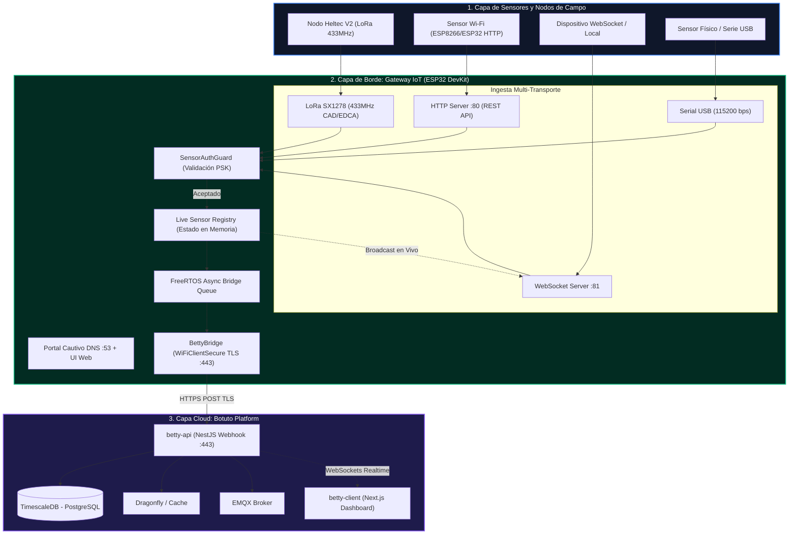
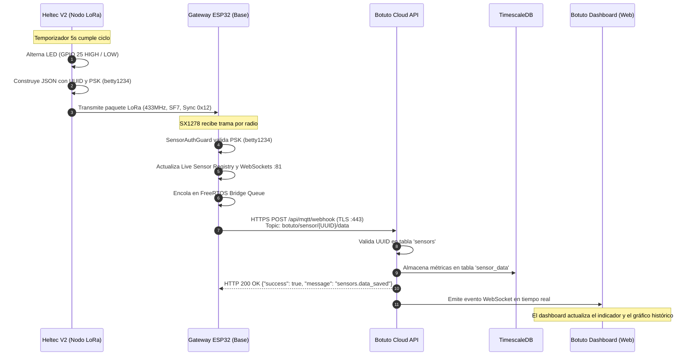

# 🌐 Botuto IoT Sensor Gateway (ESP32 + LoRa 433MHz)

## Guía de Conexión, Credenciales, Arquitectura y Manual de Ingesta de Sensores

Este módulo actúa como **Puente de Enlace (Edge Gateway)** universal. Recibe telemetría de cualquier sensor (físico o remoto) mediante múltiples interfaces, valida sus **credenciales a nivel de enlace** y retransmite los datos automáticamente a la plataforma **Botuto Platform** (TimescaleDB + WebSockets) mediante webhooks cifrados **HTTPS/TLS** para proyectarlos en tiempo real en los dashboards y gemelos digitales.

---

## 🏛️ 1. Arquitectura General del Sistema



---

## 🔑 2. Credenciales y Parámetros por Defecto

| Parámetro | Valor por Defecto | Descripción |
| :--- | :--- | :--- |
| **Red Wi-Fi AP (SSID)** | `Gateway-IoT-AP` | Red Wi-Fi local emitida por el ESP32 para configuración y monitoreo. |
| **Contraseña Wi-Fi AP** | `12345678` | Clave WPA2 del punto de acceso del gateway. |
| **IP del Gateway (AP)** | `192.168.4.1` | Dirección IP local del servidor web, DNS y WebSockets. |
| **Clave Maestra (PSK)** | `betty1234` | **Credencial obligatoria** que cada sensor debe incluir para ser aceptado. |
| **Puerto Web / REST** | `80` | Servidor HTTP del inspector y endpoint REST de ingesta. |
| **Puerto WebSockets** | `81` | Servidor WebSocket para dashboard en vivo e ingesta rápida. |
| **Frecuencia LoRa** | `433.0 MHz` | Frecuencia de radio SX1278 (SF7, BW 125 kHz, CR 4/5, Sync `0x12`). |
| **Uplink Botuto Cloud** | `betty-api.laboratorio3d.online:443` | Endpoint destino (`/api/mqtt/webhook`) con cifrado TLS/HTTPS. |

> [!TIP]
> Puedes cambiar la **Clave Maestra (PSK)**, las credenciales de tu Wi-Fi local y el host de Botuto en cualquier momento desde el **Portal Cautivo** (`http://192.168.4.1`). Los valores se almacenan de manera persistente en la memoria flash NVS del ESP32.

---

## 🚀 3. Proyecto de Ejemplo: Nodo Sensor LoRa (Heltec WiFi LoRa 32 V2)

Dentro de este repositorio se incluye un proyecto completo y probado para implementar un nodo sensor de campo con la placa **Heltec WiFi LoRa 32 V2**:

📂 **Ruta del Proyecto:** [`examples/heltec_v2_lora_led`](examples/heltec_v2_lora_led)

### ¿Qué hace este ejemplo?
* Alterna el estado del **LED integrado** (Encendido / Apagado) cada 5 segundos.
* Construye una trama de telemetría **JSON** con el `sensorId` (UUID asignado en Botuto), la clave de enlace `key`, y las métricas operativas (`led`, `state`, `counter`, `uptime_sec`).
* Transmite el paquete mediante radiofrecuencia **LoRa 433 MHz** hacia el Gateway.
* El Gateway lo recibe, valida la clave `betty1234` y lo despacha de forma segura mediante **HTTPS POST** a Botuto Cloud.

### Diagrama de Secuencia de Extremo a Extremo



### Pines de Hardware (Heltec V2)
| Periférico | Pin ESP32 (GPIO) | Función |
| :--- | :---: | :--- |
| **LED de Usuario** | `GPIO 25` | LED blanco integrado (Activo en HIGH). |
| **Control Vext** | `GPIO 21` | Alimentación de periféricos externos (Activo en LOW). |
| **LoRa SCK / MISO / MOSI** | `GPIO 5 / 19 / 27` | Bus SPI del transceptor SX1278. |
| **LoRa SS / RST / DIO0** | `GPIO 18 / 14 / 26` | Control de chip, reset e interrupción de recepción. |

👉 **Para ver la guía completa paso a paso de este ejemplo, consulta:** [`examples/heltec_v2_lora_led/README.md`](examples/heltec_v2_lora_led/README.md).

---

## 🛠️ 4. Panel de Inspección y Portal Cautivo

### Portal Cautivo e Inspector Web en Vivo

Al conectarte a la red Wi-Fi `Gateway-IoT-AP` (contraseña `12345678`), tu teléfono o computadora abrirá automáticamente la ventana del **Portal Cautivo**:

Si deseas acceder manualmente desde cualquier navegador:
👉 **`http://192.168.4.1`** (o `http://192.168.4.1/sensors`)

- **Servidor DNS Cautivo (Puerto 53 UDP)**: Resuelve cualquier dominio hacia `192.168.4.1`.
- **Sondas de Detección**: Intercepta automáticamente las comprobaciones de conectividad de Android (`/generate_204`), Apple iOS/macOS (`/hotspot-detect.html`) y Windows (`/ncsi.txt`).

**En el panel verás en tiempo real:**
- Lista de sensores conectados, su identificador y modelo.
- Interfaz de entrada (`lora`, `wifi_http`, `ws`, `adc`, `serial`).
- RSSI (dBm) y SNR de la señal de radio.
- Contador de paquetes y métricas en vivo.
- Pestaña **⚙️ Gateway Settings** para cambiar las credenciales de tu red Wi-Fi local y el host de Botuto.

---

## 📡 5. Interfaces de Ingesta para Otros Sensores

Cualquier dispositivo puede reportar métricas al Gateway utilizando cualquiera de las interfaces disponibles:

### Opción A: Vía Wi-Fi HTTP REST
Dispositivos conectados a la red del Gateway (o en la misma LAN):
* **Endpoint**: `http://192.168.4.1/api/sensor/data`
* **Método**: `POST`
* **Cabecera obligatoria**: `X-Sensor-Key: betty1234`
* **Payload**:
  ```json
  {
    "sensorId": "55f1a34e-a2ab-4ece-ade4-6d4c5808c08f",
    "model": "ESP8266-DHT22",
    "metrics": { "temperatura": 24.5, "humedad": 60.2 }
  }
  ```

### Opción B: Vía Radio LoRa 433 MHz
Nodos remotos sin conexión a Internet (SX1278 a 433 MHz):
* **Formato JSON**:
  ```json
  {
    "sensorId": "55f1a34e-a2ab-4ece-ade4-6d4c5808c08f",
    "key": "betty1234",
    "metrics": { "led": 1, "state": "ON" }
  }
  ```
* **Formato Texto Ligero ($DATA)**:
  ```text
  $DATA,ID=55f1a34e-a2ab-4ece-ade4-6d4c5808c08f,KEY=betty1234,TEMP=22.4,HUM=55.0*
  ```

### Opción C: Vía WebSockets (Puerto 81)
Aplicaciones de alta velocidad o agentes en tiempo real (`ws://192.168.4.1:81`):
1. Handshake de autenticación:
   ```json
   { "type": "auth", "id": "WS-NODE-01", "key": "betty1234" }
   ```
2. Envío de telemetría:
   ```json
   {
     "type": "sensor_data",
     "sensorId": "55f1a34e-a2ab-4ece-ade4-6d4c5808c08f",
     "key": "betty1234",
     "metrics": { "potencia": 120.5, "voltaje": 3.3 }
   }
   ```

### Opción D: Vía Puerto Serie USB (115200 bps)
Microcontroladores conectados físicamente por USB:
```json
{"id":"55f1a34e-a2ab-4ece-ade4-6d4c5808c08f","key":"betty1234","metrics":{"luz_lux":650}}
```

---

## 🔗 6. Enlace hacia Botuto Cloud

El Gateway corre en modo dual Wi-Fi (`WIFI_AP_STA`):
1. **AP (`Gateway-IoT-AP`)**: Punto de acceso local para sensores y portal de gestión.
2. **STA**: Se conecta a la red Wi-Fi de tu laboratorio o campus con salida a Internet.

Al recibir telemetría válida, el motor `BettyBridge` la encola en una tarea FreeRTOS y realiza una petición HTTPS segura con `WiFiClientSecure` hacia:

```http
POST https://betty-api.laboratorio3d.online/api/mqtt/webhook
Content-Type: application/json

{
  "topic": "botuto/sensor/55f1a34e-a2ab-4ece-ade4-6d4c5808c08f/data",
  "payload": {
    "origin_type": "sensor",
    "gateway_id": "GATEWAY-ESP32-01",
    "source_sensor": "55f1a34e-a2ab-4ece-ade4-6d4c5808c08f",
    "interface": "lora",
    "rssi": -65,
    "snr": 9.5,
    "metrics": {
      "led": 1,
      "state": "ON",
      "counter": 12,
      "uptime_sec": 60
    }
  }
}
```

La plataforma Botuto almacena los registros en **TimescaleDB** y emite los eventos en tiempo real a los dashboards web y representaciones en gemelos digitales.
