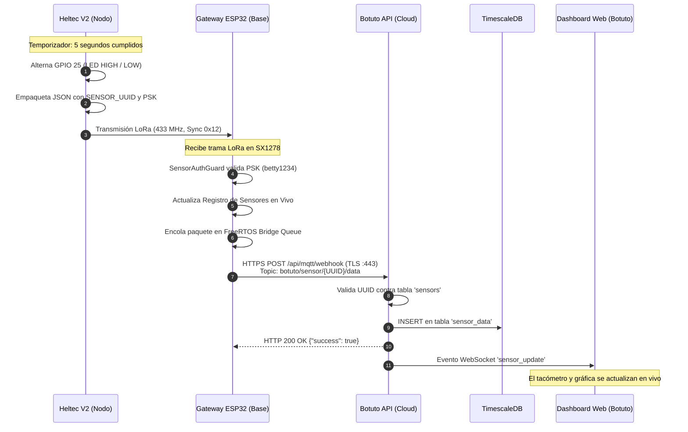

# 🚀 Guía Completa de Nodo Sensor LoRa (Heltec WiFi LoRa 32 V2)

Este proyecto de ejemplo implementa un **Nodo Sensor de Campo** utilizando la placa **Heltec WiFi LoRa 32 (V2)**. Alterna el estado del LED integrado (Encendido / Apagado cada 5 segundos) y transmite su estado y métricas operativas por radiofrecuencia **LoRa (433 MHz)** hacia el **Gateway IoT Base**, el cual valida las credenciales y reenvía los datos por **HTTPS** a la plataforma **Botuto (TimescaleDB + WebSockets)** en tiempo real.

---

## 📐 1. Arquitectura de Comunicación de Extremo a Extremo

```mermaid
flowchart LR
    subgraph Campo ["Nodo de Campo (Batería / Remoto)"]
        H[Heltec WiFi LoRa 32 V2] -->|Alterna LED| LED[GPIO 25 - User LED]
        H -->|Construye JSON| LTX[SX1278 Transceiver 433 MHz]
    end

    subgraph EnlaceRadio ["Enlace LoRa (Sin Internet)"]
        LTX -->|LoRa 433 MHz / SF7 / BW 125kHz| LRX[SX1278 Gateway]
    end

    subgraph GatewayBase ["Gateway Base IoT (ESP32 DevKit)"]
        LRX --> SGuard["SensorAuthGuard (Valida PSK)"]
        SGuard --> SReg["Live Sensor Registry"]
        SReg --> BQueue["FreeRTOS Bridge Queue"]
        BQueue --> BBridge["BettyBridge (WiFiClientSecure)"]
    end

    subgraph Nube ["Botuto Cloud Platform"]
        BBridge -->|HTTPS POST TLS :443| API["betty-api (NestJS Webhook)"]
        API --> DB[(TimescaleDB - sensor_data)]
        API --> WS["WebSockets Gateway"]
        WS --> UI["Dashboard Web / Gemelo Digital"]
    end

    style Campo fill:#1e293b,stroke:#3b82f6,stroke-width:2px,color:#fff
    style EnlaceRadio fill:#0f172a,stroke:#8b5cf6,stroke-dasharray: 5 5,color:#fff
    style GatewayBase fill:#1e293b,stroke:#10b981,stroke-width:2px,color:#fff
    style Nube fill:#1e293b,stroke:#f59e0b,stroke-width:2px,color:#fff
```



---

## 🔄 2. Diagrama de Secuencia del Ciclo de Vida del Dato



---

## 📌 3. Asignación de Pines (Hardware Pinout - Heltec V2)

La placa **Heltec WiFi LoRa 32 V2** integra un microcontrolador ESP32-D0WDQ6 con pantalla OLED SSD1306 y transceptor LoRa SX1276/SX1278 conectados internamente por bus SPI:

| Periférico / Señal | Pin ESP32 (GPIO) | Descripción / Función |
| :--- | :---: | :--- |
| **LED de Usuario** | **GPIO 25** | LED blanco integrado (Nivel ALTO = Encendido). |
| **Control Vext** | **GPIO 21** | Alimentación de periféricos externos (Nivel BAJO = Activo). |
| **LoRa SCK** | **GPIO 5** | Reloj del bus SPI hacia el SX1278. |
| **LoRa MISO** | **GPIO 19** | Entrada de datos SPI desde el transceptor. |
| **LoRa MOSI** | **GPIO 27** | Salida de datos SPI hacia el transceptor. |
| **LoRa SS (NSS)** | **GPIO 18** | Selección de chip LoRa SPI. |
| **LoRa RESET** | **GPIO 14** | Pin de reinicio por hardware del SX1278. |
| **LoRa DIO0** | **GPIO 26** | Interrupción por recepción de paquetes finalizada. |

> [!IMPORTANT]
> En la Heltec V2, el pin **GPIO 21 (Vext)** debe mantenerse en `LOW` para suministrar energía a los componentes integrados. El código ya realiza esto automáticamente en `setup()`.

---

## 📻 4. Parámetros de Radiofrecuencia LoRa

Para asegurar la sincronización y correcta recepción en el Gateway, los parámetros de modulación deben coincidir de forma exacta:

| Parámetro | Valor | Notas |
| :--- | :---: | :--- |
| **Banda de Frecuencia** | `433E6` (433.0 MHz) | Cambiar a `868E6` o `915E6` según la antena y región de tu placa. |
| **Spreading Factor (SF)** | `7` | Equilibrio óptimo entre alcance y tasa de transferencia. |
| **Signal Bandwidth (BW)**| `125E3` (125 kHz) | Ancho de canal estándar de banda estrecha. |
| **Coding Rate (CR)** | `4/5` (valor 5) | Corrección de errores hacia adelante (FEC). |
| **Sync Word** | `0x12` | Palabra de sincronización privada del ecosistema Gateway. |
| **Potencia TX** | `17 dBm` | Máximo rendimiento de transmisión. |
| **CRC Hardware** | Habilitado | Protección contra paquetes corruptos por ruido. |

---

## 📋 5. Formato del Paquete JSON de Telemetría

El nodo genera y transmite una trama JSON compacta por el aire:

```json
{
  "sensorId": "55f1a34e-a2ab-4ece-ade4-6d4c5808c08f",
  "key": "betty1234",
  "model": "Heltec-V2",
  "metrics": {
    "led": 1,
    "state": "ON",
    "counter": 42,
    "uptime_sec": 210
  }
}
```

* **`sensorId`**: **UUID obligatorio** generado por la plataforma Botuto al registrar el sensor.
* **`key`**: Clave de enlace (**PSK**) configurada en el Gateway (`betty1234` por defecto).
* **`model`**: Identificador de hardware o modelo (`Heltec-V2`).
* **`metrics`**: Objeto clave-valor con las lecturas físicas que TimescaleDB almacenará y graficará.

---

## 🛠️ 6. Guía de Puesta en Marcha Paso a Paso

### Paso 1: Registrar el Sensor en Botuto Platform
1. Ingresa a tu instancia de Botuto (ej: [botuto.laboratorio3d.online](https://botuto.laboratorio3d.online)).
2. En el menú lateral izquierdo, haz clic en **Sensores** y pulsa el botón **+ Registrar Nuevo Sensor**.
3. Rellena los datos:
   - **Nombre del Sensor**: ej. `Heltec-LED`.
   - **Descripción**: ej. `Heltec V2 con Indicador de LED`.
   - **Asignar a Equipo**: `personal` (o tu equipo).
4. Haz clic en **Crear**.
5. Copia el **UUID** que aparece en el modal del Topic MQTT:
   `botuto/sensor/xxxxxxxx-xxxx-xxxx-xxxx-xxxxxxxxxxxx/data`
   *(El fragmento entre `sensor/` y `/data` es tu UUID único).*

### Paso 2: Configurar el UUID en el Código del Nodo
Abre el archivo [src/main.cpp](file:///d:/dev/Investigacion%20Metaversos%20Gemelos%20Digitales/Betty/betty-gateway/examples/heltec_v2_lora_led/src/main.cpp) y actualiza la constante:

```cpp
// UUID asignado en Botuto para tu sensor:
const char* SENSOR_UUID = "55f1a34e-a2ab-4ece-ade4-6d4c5808c08f";
```

### Paso 3: Compilar y Flashear con PlatformIO
Conecta la placa Heltec V2 por USB a tu computadora y ejecuta:

```bash
cd examples/heltec_v2_lora_led
pio run -t upload
```

O desde la interfaz gráfica de PlatformIO en VS Code, selecciona el entorno `heltec_wifi_lora_32_V2` y pulsa **Upload**.

### Paso 4: Monitoreo Serial

Abre el monitor serial a **115200 baudios**:

```bash
pio device monitor -b 115200
```

Salida esperada en el nodo:
```text
==================================================
  HELTEC LORA V2 -> BETTY SENSOR NODE (LED DEMO)  
==================================================
[LoRa] Iniciando radio en 433.0 MHz...
[LoRa] Transceptor listo y configurado.
[Config] Sensor UUID: 55f1a34e-a2ab-4ece-ade4-6d4c5808c08f
[Config] Clave Gateway: betty1234
--------------------------------------------------

[Nodo] LED cambiado a: ENCENDIDO [HIGH] (Paquete #1)
[LoRa TX] Enviando: {"sensorId":"55f1a34e-a2ab-4ece-ade4-6d4c5808c08f","key":"betty1234","model":"Heltec-V2","metrics":{"led":1,"state":"ON","counter":1,"uptime_sec":5}}
[LoRa TX] Paquete enviado con exito.
```

---

## 🔍 7. Verificación en el Gateway y en Botuto

1. **En la consola del Gateway (ESP32)**:
   ```text
   [SensorManager] Ingested [lora] '55f1a34e-a2ab-4ece-ade4-6d4c5808c08f' (Heltec-V2) | Metrics: {"led":1,"state":"ON",...}
   [BettyBridge] Telemetry dispatched successfully to https://betty-api.laboratorio3d.online/api/mqtt/webhook [HTTP 200]
   ```

2. **En el Inspector Web local del Gateway**:
   Abre `http://192.168.4.1/sensors` conectado a la red `Gateway-IoT-AP`. Verás tu sensor aparecer de inmediato en verde con la interfaz `lora` y su RSSI/SNR medidos.

3. **En el Dashboard de Botuto Cloud**:
   En la vista del sensor (`/sensors/<UUID>`), el indicador cambiará a **Activo** y el registro histórico mostrará las alternancias de estado `led: 1` y `led: 0` junto con su marca de tiempo en TimescaleDB.

---

## ❓ 8. Solución de Problemas (Troubleshooting)

| Síntoma | Posible Causa | Solución |
| :--- | :--- | :--- |
| **LED parpadea rápido en el arranque** | Error al inicializar el radio LoRa por hardware. | Verifica que la placa sea Heltec V2 y que la antena esté conectada firmemente. |
| **El Gateway muestra `Uplink error: HTTP -1`** | El Gateway no tiene salida a Internet o la URL es incorrecta. | Conecta el Gateway a tu red Wi-Fi desde el portal cautivo y verifica que el host sea `betty-api.laboratorio3d.online` en puerto `443`. |
| **El Gateway ignora los paquetes silenciosamente** | La clave `key` no coincide con la configurada en el Gateway. | Asegúrate de que `GATEWAY_PSK` sea igual a `betty1234` (o la que configuraste en tu Gateway). |
| **Botuto responde `HTTP 404: Sensor not found`** | El UUID no existe en la base de datos de Botuto. | Verifica que hayas creado primero el sensor en el panel web y copiado su UUID exacto sin espacios. |
